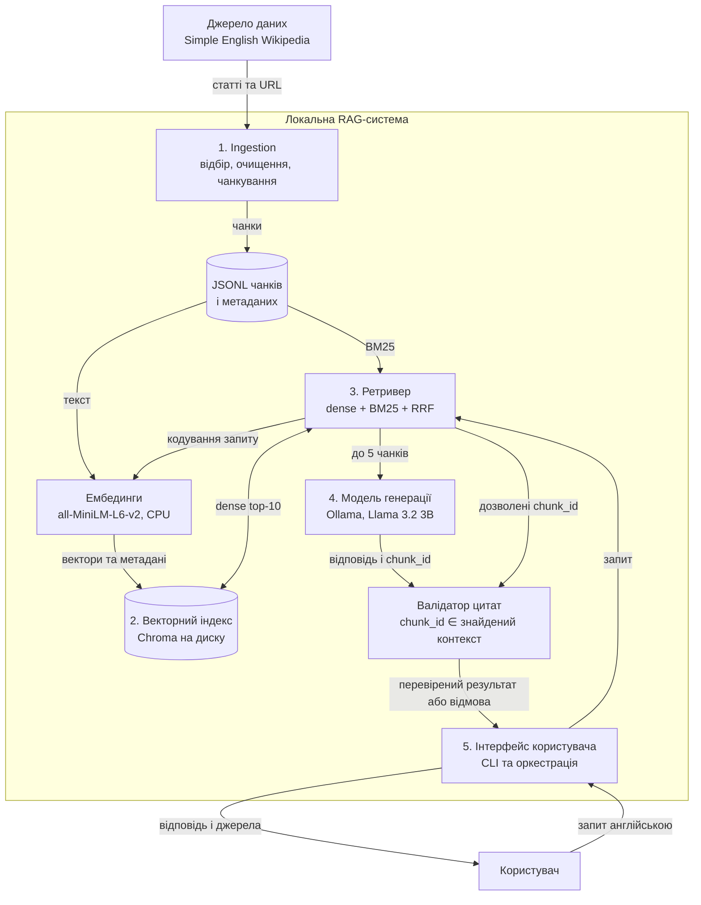

# Архітектура географічного RAG-довідника

Спрощена блок-схема. Кожен із п'яти компонентів, обов'язкових за методичкою,
має окремий вузол. Схема описує заплановану систему лабораторних № 1–5.

## Контракти

| Межа | Поля та умови |
| --- | --- |
| Ingestion → JSONL | `doc_id`, `title`, `url`, `source_snapshot`, `license`, `chunk_index`, `chunk_id`, `text`; UTF-8, непорожній текст, унікальний chunk_id. |
| Embeddings → index | Вектор із 384 скінченних чисел, той самий chunk_id, збережена версія моделі. Нормалізовані вектори; cosine distance. |
| Retriever → generation | До п'яти різних чанків із chunk_id, текстом, URL і score; нуль результатів спричиняє відмову без виклику генератора. |
| Generation → validator | Статус `answered` або `insufficient_context`, текст `answer`, список `citations`. Кожен наведений ID має належати поточному контексту. |
| Validator → CLI | Для `answered` потрібна хоча б одна валідна цитата. Помилка цитат → одна повторна генерація → контрольована відмова за повторної помилки. |

Валідність ідентифікатора не доводить, що джерело підтверджує твердження.
Підтвердженість змісту буде перевірятися вручну на еталонному наборі.
Тайм-аут Ollama або недоступність індексу — окрема помилка виконання, яка
не повинна видаватися за змістову відмову через недостатність корпусу.

Оркестрація: CLI → ретривер → генерація → валідатор → CLI.
Прийом даних та індексація виконуються окремо від користувацького запиту.
Зміна моделі ембедингів або чанкування вимагає перебудови індексу.
